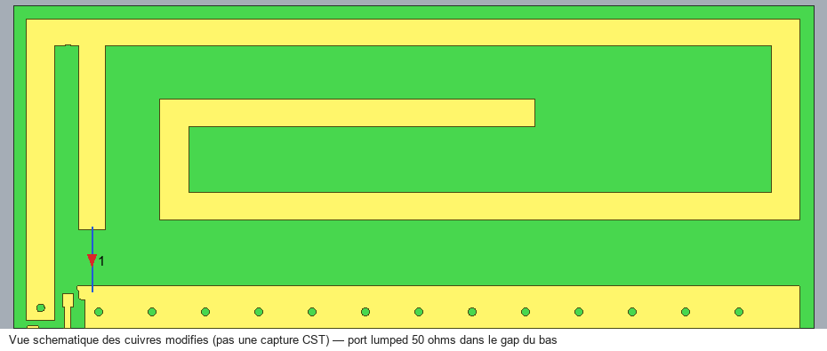

# Antenne : piste raccordée en haut et lumped dans le gap inférieur

La fine piste verticale centrale a été retirée. Le rectangle auparavant placé en bas est remplacé par une piste de cuivre raccordée au haut de l'antenne, sur environ trois quarts de la hauteur. Un unique port discret/lumped de **50 Ω** relie son extrémité basse à la masse dans le gap restant. La branche de court-circuit de l'IFA à gauche est conservée.

## Fichiers à ouvrir

[Projet CST 2019](modeles/SmartPot_V3_ANTENNE_PISTE_HAUT_3QUARTS_LUMP_2019.cst). Conserver **le dossier compagnon du même nom à côté du fichier `.cst`**. Le dossier contient les données de modèle natives et les résultats 1D sauvegardés. Les caches `ModelCache` et `Temp` se régénèrent ; ils ne sont pas publiés.

La capture globale native est disponible [ici](captures/CST_vue_globale.png). La grosse flèche rouge de visualisation CST peut masquer la zone d'alimentation ; le schéma ci-dessus montre sa géométrie sans modifier une capture.

## Géométrie de référence X0

| Paramètre | Valeur |
|---|---:|
| Largeur de la nouvelle piste | 1 mm |
| Longueur de cuivre depuis le haut | 7 mm |
| Épaisseur du cuivre | 0,035 mm |
| Bornes X de la piste | 52,45 à 53,45 mm |
| Centre X de l'alimentation | 52,95 mm |
| Bornes Y de la piste | −58,4 à −51,4 mm |
| Recouvrement avec le cuivre supérieur de l'antenne | 0,1 mm² |
| Écart horizontal au bord du brin gauche | environ 0,904 mm |
| Gap inférieur sans cuivre au droit du port | environ 2,1 mm |
| Port : point sur la piste | (52,95 ; −58,3 ; 0,8) mm |
| Port : point sur la masse | (52,95 ; −60,75 ; 0,8) mm |
| Longueur entre les points du port | 2,45 mm |

Les quatre couches de cuivre, les vias et la carte sont conservés. La suppression de la fine piste centrale découple l'ancienne chaîne RF du nouveau point d'alimentation. R4 et R6 restent des ponts conducteurs idéalisés à 0 Ω. Aucun condensateur de 8,2 pF ni second port de test n'est utilisé dans cette version. Le fichier KiCad d'origine n'a pas été modifié.

## Résultat vérifié à 868 MHz

| Grandeur | Valeur |
|---|---:|
| S11 natif | **−11,020993 dB** |
| S11 complexe | −0,18071532 − j0,21538746 |
| Impédance d'entrée, référence 50 Ω | 31,9668 − j14,9525 Ω |
| Objectif S11 ≤ −14 dB à 868 MHz | **Non atteint** |
| Cellules hexaédriques | 856 520 |
| Résidu du système atteint | 8,8227 × 10⁻⁷ |
| Itérations | 104 |
| Durée native | 16 min 03 s |

Ce calcul de référence, déjà engagé avant la demande de passage au temporel, est un **point fréquentiel unique**. Les trois exports natifs, le calcul d'impédance et les journaux sont dans [`resultats/`](resultats/). Le fichier magnitude dB et la recomposition depuis les parties réelle et imaginaire donnent le même S11. Aucun minimum de résonance ni largeur de bande ne peut être annoncé à partir de ce point seul.

## Réglage suivant et limites

L'objectif reste **−14 dB ou mieux à 868 MHz**. L'écartement en X peut varier en conservant la piste raccordée en haut, sa largeur, sa longueur et le lumped vertical en bas. Les essais suivants et la validation sont prévus avec **HF Time Domain**. Aucun gain supplémentaire n'est annoncé avant calcul.

Le FR4 est provisoire : εr = 4,3 et tanδ = 0,02. Le solveur fréquentiel hexaédrique de cette référence traite le cuivre comme PEC, conformément à son avertissement natif. La convergence du système linéaire ne remplace pas une étude de convergence du maillage. Les boîtiers et circuits internes des composants, le module complet et le pot ne sont pas modélisés : ce résultat n'est pas une mesure de carte assemblée.
