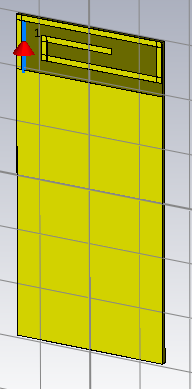
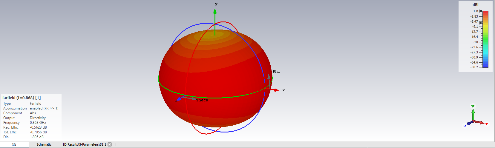

# Simulations CST SmartPot — 868 MHz

## Modèles actuels — 28 octobre 2026

- **[V4, excitation U1.12 vers GND](V4_U112_868/README.md)** : résultat temporel M2 −8,96572 dB à 868 MHz ; minimum −9,02577 dB à 868,9 MHz. Convergence du maillage non démontrée. Projets complets, exports S11/rayonnement et audits disponibles.
- **[V5, proposition d’adaptation](V5_ADAPTATION_868/README.md)** : inductance série idéale 4,3 nH à l’emplacement R6, condensateur idéal 3,9 pF à C6. Aucun résultat de cette variante publié dans le commit 8875b36.
- **[Référence de géométrie X0](ANTENNE_868_3QUARTS/README.md)** : −11,02 dB à 868 MHz sur un point fréquentiel à port lumped et cuivre PEC ; modèle distinct de la V4 alimentée côté radio.

Les projets antérieurs à la V4 sont regroupés dans [old/](../old/README.md). Les valeurs de chaque modèle s’interprètent avec ses matériaux, son port et son maillage. Aucun résultat n’est une mesure sur prototype.

## Antenne initiale — historique archivé

Fichier [TP1_M2_Smart_2-3.cst](../old/CST/TP1_M2_Smart_2-3.cst), capture de référence −17,9 dB à 869 MHz. Les sections suivantes décrivent cet ancien modèle, pas la V4/V5 actuelle.

## Modèle et configuration lus dans le projet final

| Paramètre | Valeur |
|---|---:|
| x_PCB | 29,1 mm |
| y_PCB | 59,1 mm |
| z_PCB | 0,8 mm |
| Y_ANT | 10 mm |
| MET_TH | 0,035 mm |
| Substrat | Epoxy resin, εr=4, pertes diélectriques nulles |
| Cuivre | Copper (pure) |
| Plage finale | 0,75–1 GHz |
| Solveur | HF Time Domain |
| Port | Discrete Port, S-Parameter, 50 Ω |

Le dernier port actif de l'historique est défini par P1=(-13 ; 28,55 ; 0,035) mm et P2=(-13 ; 19 ; 0) mm, dans le repère global, direction inversée. Ce port de simulation s'étend sur plusieurs millimètres : il ne représente pas à lui seul une piste d'alimentation fabriquée. Son équivalent physique doit être défini et vérifié lors du transfert vers KiCad.

La géométrie est une antenne imprimée repliée avec une branche de court-circuit reliée au plan de masse et un point d'alimentation distinct, de type F inversé (IFA). Dans cette topologie, la liaison de la branche de court-circuit à GND est intentionnelle ; l'analyse précédente fondée sur un monopole isolé ne s'applique pas directement. Les six rectangles ANT1..ANT6 sont décrits dans [la fiche de géométrie](../old/CST/geometrie_finale.json). L'historique comporte aussi un import SAT intermédiaire ; les rectangles exportés ne remplacent pas une inspection du modèle final dans CST.

## Captures fournies

| Lecture de la capture S11 | Valeur |
|---|---:|
| Minimum affiché | 0,869 GHz / −17,892 dB |
| Marqueur gauche | 0,8667 GHz / −9,9109 dB |
| Marqueur droit | 0,87126 GHz / −9,7531 dB |

Les marqueurs voisins sont proches de −10 dB, mais ne sont pas les intersections exactes de ce seuil. La largeur de bande à −10 dB et S11 exactement à 868 MHz doivent être extraits de la courbe numérique ; ils ne sont pas inventés à partir de cette image.

La capture est en **directivité**, pas en gain réalisé. À 0,868 GHz elle affiche :

- directivité maximale : **1,805 dBi** ;
- rendement de rayonnement : **−0,5623 dB**, soit **environ 87,9 %** ;
- rendement total : **−0,7056 dB**, soit **environ 85,0 %**.

Ces chiffres proviennent des captures fournies avec la version finale ; la simulation n'a pas été relancée ici. Les fichiers de résultats numériques et le journal de convergence ne sont pas fournis. Le modèle ne reproduit pas encore le PCB KiCad à quatre couches, le boîtier du pot et les composants RF 0603. Les performances annoncées sont donc celles du modèle simulé, pas des mesures sur une carte fabriquée.

## Simulation du PCB V4 — 28 octobre 2026

La [variante V5 avec adaptation sur R6/C6](V5_ADAPTATION_868/README.md) est également disponible : inductance série de 4,3 nH et condensateur de 3,9 pF vers GND, R4 conservée à 0 Ω. Calcul temporel lancé, objectif −16 dB à 868 MHz ; aucun résultat V5 n'est encore publié.

Les [projets CST V4, résultats numériques et courbes](V4_U112_868/README.md) sont disponibles. Le maillage M2 donne **−8,97 dB à 868 MHz**, avec un minimum de **−9,03 dB à 868,9 MHz**. La convergence du maillage reste à démontrer et l'objectif de −14 dB n'est pas atteint. Le port est côté U1.12 vers GND, avec le nouveau raccord cuivre physique et R4/R6 montées nominalement à 0 Ω. Ces résultats ne remplacent pas la confirmation de l'empilage fabricant, le retour de M. Ferrero et les mesures au VNA.

## Avant intégration au PCB

1. Reproduire la branche de court-circuit, le radiateur et un raccordement RF physique compatible avec le port étudié.
2. Réconcilier les dimensions CST (29,1 × 59,1 mm) et KiCad (30 × 60 mm), ainsi que la zone de masse et l'empilage réel.
3. Vérifier dans CST l'effet de l'alimentation réelle, des couches internes et du pot, puis ajuster l'adaptation en 0603.
4. Vérifier ERC/DRC après intégration et mesurer l'adaptation sur prototype.

`explorations/` contient les anciennes propositions de macros et de coordonnées. Elles sont historiques et ne constituent pas l'antenne finale choisie.

## Transfert dans KiCad effectué

La géométrie finale est maintenant transposée sur A1, avec une largeur réduite de 29,1 à 29,0 mm, le PCB 30 × 60 mm conservé et un raccord RF physique ajouté à la place de la longue source lumped. Le court-circuit IFA vers GND est conservé. Les [exports de la carte adaptée](../old/CST/integration_kicad/README.md) et la [fiche d’intégration](../old/pot_fleur/docs/INTEGRATION_ANTENNE_CST.md) décrivent les différences à resimuler. Les captures de cette page restent celles du modèle original.

## Reprise des travaux V3 du 26–27 octobre 2026

Voir [REPRISE_CST_V3.md](../old/REPRISE_CST_V3.md) pour le PCB complet reconstruit, le refus du solveur Learning Edition, les essais réduits et les instructions de reprise sur un autre ordinateur.
