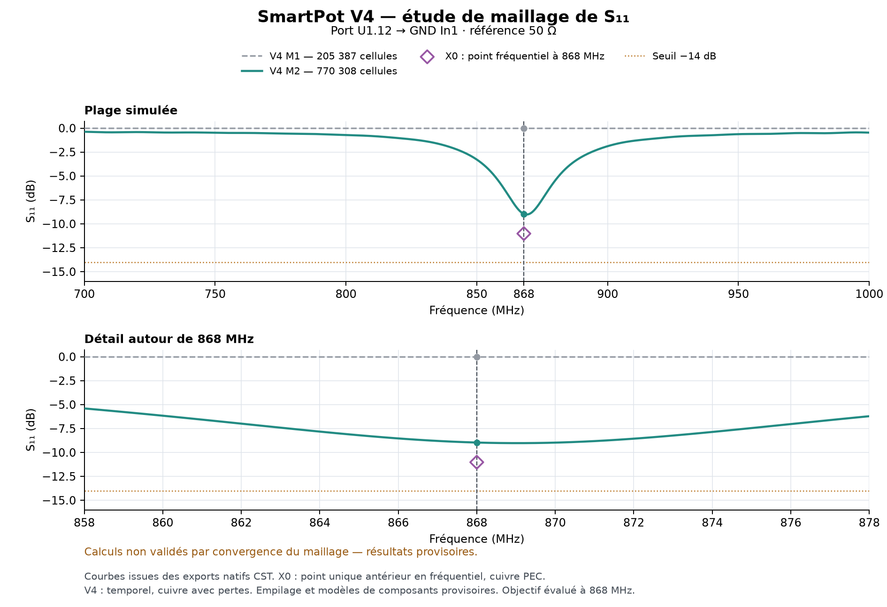
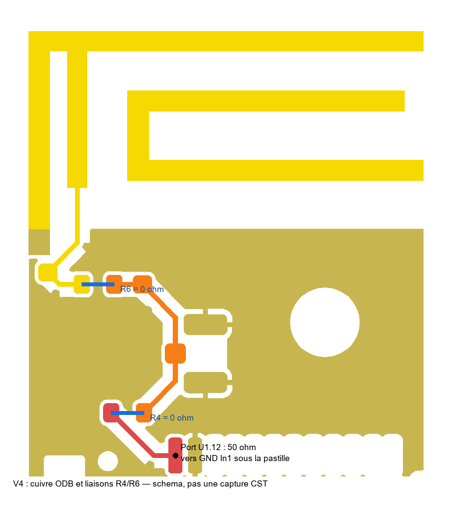

# SmartPot V4 — CST 2019, excitation U1.12 vers GND

État publié le 28 octobre 2026 : **M2 terminé avec succès, convergence du maillage non démontrée, objectif −14 dB à 868 MHz non atteint**. M3 est préparé à 959 112 cellules ; aucun résultat M3 n'est inclus dans cette publication.

## Résultats provisoires M2

| Grandeur | M2 |
|---|---:|
| Solveur | Temporel, 700–1 000 MHz |
| Maillage | 770 308 cellules ; 3 cellules dans la hauteur du port |
| Arrêt | Critère d'énergie −50 dB atteint avec succès |
| Durée native | 2 h 31 min 24 s |
| S11 à 868 MHz | **−8,96572 dB** |
| Minimum échantillonné | **−9,02577 dB à 868,9 MHz** |
| Bande sous −10 dB / −14 dB | Aucune dans la plage simulée |
| Impédance à 868 MHz | 23,755 + j1,301 Ω |
| Rendement de rayonnement à 868 MHz | 43,69 % |
| Rendement total à 868 MHz | 38,14 % |
| Gain réalisé maximal à 868 MHz | −2,400 dBi |

Les rendements natifs CST sont exportés en dB, puis convertis en pourcentages. La cohérence entre puissance acceptée, rendement total et gains a été vérifiée. Ces contrôles ne remplacent pas la convergence du maillage.

Le maillage initial M1 (205 387 cellules) donnait −0,02676 dB à 868 MHz : cet écart important interdit de qualifier M2 de résultat convergé. M1 est conservé pour documenter cette dépendance numérique, pas pour représenter les performances réelles de la carte.

Le point **X0 −11,020993 dB à 868 MHz** est une référence V3 antérieure en fréquentiel avec cuivre PEC et une autre alimentation. Ce n'est ni un résultat V4 ni une courbe mesurée.

## Ouvrir les projets

- [Projet M2 et résultats natifs](modeles/SmartPot_V4_U112_TD_M2_2019.zip)
- [Projet M1 et résultats natifs, non convergés](modeles/SmartPot_V4_U112_TD_M1_2019.zip)

Télécharger l'archive complète puis **tout extraire dans un dossier local**. Ouvrir le fichier `.cst` dans CST Studio Suite 2019 en conservant le dossier compagnon de même nom à côté. Ne pas ouvrir le projet directement dans le ZIP. Les archives contiennent la géométrie et les résultats natifs enregistrés, dont S11 et champ lointain ; les fichiers temporaires, caches, verrous et états de travail régénérables `Model.sam` sont exclus. Les sommes SHA-256 et exclusions figurent dans [le manifeste](modeles/manifest.json).

Les [exports numériques](resultats/) comprennent S11 complexe, amplitude, Touchstone 50 Ω, champ lointain et journaux. Les [audits](audits/) documentent l'empilage, les connexions et le maillage. Les [macros de reproduction](reproduction/) conservent les réglages exécutés ; les chemins sont à adapter au dossier local.

## Carte et alimentation représentées

Source : [ODB V4](../../pot_fleur_v4_nouvelle_antenne/CST_import/SmartPot_V4_RF_PROVISOIRE_ODB.zip) du dépôt, SHA-256 `e922e806f04505c7517026d6fd5e8b761fbe7830753f8ee3d316c0e51208a337`. Reconstruction de quatre couches, plans de masse, 228 perçages métallisés dont 204 vias, deux perçages non métallisés et nouveau raccord cuivre physique. M1 contient 557 solides ; M2 contient 559 solides après partition du même cuivre pour le maillage, sans changement de géométrie physique.

Le **port unique de 50 Ω est placé entre U1.12 et GND In1**, de `(57,925 ; −71,965 ; 0,765)` à `(57,925 ; −71,965 ; 0,638)` mm. Il représente la source RF au niveau de la radio ; 50 Ω est la référence de simulation, pas une résistance supplémentaire à monter.

R4/R6 montées nominalement à 0 Ω sont représentées par des liaisons en cuivre surélevées, de conductivité finie et avec des parasites géométriques approximatifs. C6/L1/J3 sont DNP d'après le KiCad. Le signal parcourt U1.12 → R4/R6 → nouveau raccord → antenne ; le court-circuit intentionnel de l'IFA vers la masse est conservé. Les deux anciennes extrémités du long port se trouvent désormais sur le cuivre RF continu : ce port ne doit pas traverser la nouvelle piste.

Empilage provisoire de bas en haut, en mm : B.Cu `0–0,035`, FR4 `0,035–0,162`, In2 `0,162–0,197`, cœur `0,197–0,603`, In1 `0,603–0,638`, FR4 `0,638–0,765`, F.Cu `0,765–0,800`. Cuivre 35 µm, FR4 εr = 4,3 et tanδ = 0,02 ; métallisation des fûts supposée 25 µm. Les boîtiers et circuits internes des composants, le pot et le vernis ne sont pas caractérisés dans ce modèle.

## Suite de la validation

Terminer un contrôle de maillage plus fin avant d'attribuer l'écart au PCB ou d'ajuster l'adaptation. L'objectif reste S11 ≤ −14 dB à 868 MHz ; aucun déplacement artificiel du port ni changement de normalisation n'a été utilisé pour l'obtenir.

**Avant fabrication : confirmer l'empilage fabricant et obtenir le retour de M. Ferrero.** La mesure au VNA sur prototype permettra ensuite la validation et l'ajustement final. Ces résultats sont simulés, pas mesurés.
