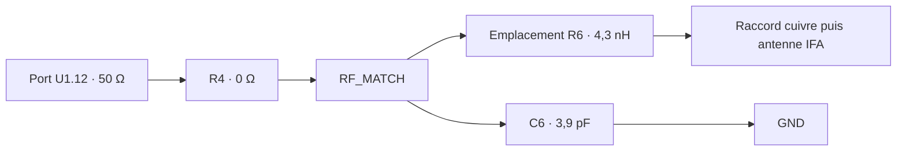

# SmartPot V5 — proposition d'adaptation RF

Version de travail du 28 octobre 2026, dérivée de la géométrie V4 M2. Ce projet est une **variante d'assemblage pour simulation**, pas une carte KiCad V5 validée pour fabrication. Le calcul temporel a été lancé à **14 h 08 (heure de Paris)**. Aucun résultat V5 n'est inclus dans cette publication initiale.

## Projet CST

[Télécharger le projet V5 avec son dossier compagnon](modeles/SmartPot_V5_R6L4p3_C6C3p9_TD_M2_2019.zip). Extraire entièrement le ZIP dans un dossier local, puis ouvrir le fichier `.cst` dans CST 2019 avec son dossier de même nom à côté. Cette archive contient le modèle enregistré avant calcul, sans les résultats d'un solveur encore en cours. Son intégrité ZIP et son empreinte SHA-256 sont contrôlées ; voir [le manifeste](modeles/manifest.json).

Contrôles effectués avant lancement : **558 solides, deux éléments L/C, 807 240 cellules, trois cellules sur la hauteur du port**. Les valeurs natives et coordonnées des composants sont dans [l'audit de l'adaptation](audits/SmartPot_V5_R6L4p3_C6C3p9_TD_M2_2019_matching_audit.txt) ; le [contrôle du maillage](audits/SmartPot_V5_R6L4p3_C6C3p9_TD_M2_2019_mesh_audit.json) vérifie les plans de grille réels.

## Assemblage proposé

- R4 : liaison nominale 0 Ω conservée.
- Emplacement R6 : liaison cuivre retirée, inductance série idéale 4,3 nH entre ses deux contacts.
- Emplacement C6 : condensateur idéal 3,9 pF entre RF_MATCH et GND, auparavant DNP.
- L1 et J3 restent DNP.
- Port inchangé : U1.12 vers GND In1, 50 Ω ; nouveau raccord cuivre et court-circuit IFA conservés.

Objectif : S11 ≤ −16 dB à 868 MHz. **Aucun résultat V5 disponible à la création**. Le calcul analytique des valeurs 4,3 nH / 3,9 pF utilisait le plan U1.12 ; le placement réel sur R6/C6 est différent, donc l'EM doit vérifier et éventuellement corriger ces valeurs. Le résultat idéal analytique ne constitue pas une prévision validée du PCB.

La V4 M2 publiée donnait −8,96572 dB à 868 MHz et un minimum de −9,02577 dB à 868,9 MHz. Sa convergence numérique n'est pas démontrée ; la V5 doit être vérifiée au même niveau de maillage, puis avec un raffinement supplémentaire avant validation.

Simulation lancée : CST 2019, solveur temporel 700–1 000 MHz, 4 threads, critère d'énergie −50 dB, champ lointain à 868 MHz. Limite de licence : 1 000 000 cellules. Conserver le fichier CST avec son dossier compagnon de même nom.

Les macros de [reproduction](reproduction/) suivent cet ordre : création de la variante depuis une copie V4 M2 avec `configure_v5.mcr`, réapplication du profil fin `mesh_v5.mcr` après modification de l'historique, contrôle `audit_matching.mcr` et contrôle externe du maillage, puis `run_temporal.mcr`. La réapplication du maillage est nécessaire car la modification d'historique peut réinitialiser ses réglages. Ne pas relancer la macro de création sur la V5 déjà modifiée. Les paramètres `V5_L_nH` et `V5_C_pF` sont enregistrés pour les essais d'adaptation ultérieurs.

Les composants L/C sont idéaux, sans pertes ni modèle constructeur. Les pistes, contacts, vias et diélectriques restent ceux du modèle V4, avec leurs approximations et leur empilage provisoire de 0,8 mm (Cu 35 µm, FR4 εr 4,3 / tanδ 0,02). Boîtiers, module radio interne, pot et vernis ne sont pas caractérisés. Confirmer l'empilage fabricant, obtenir le retour de M. Ferrero et mesurer au VNA avant validation de fabrication.
