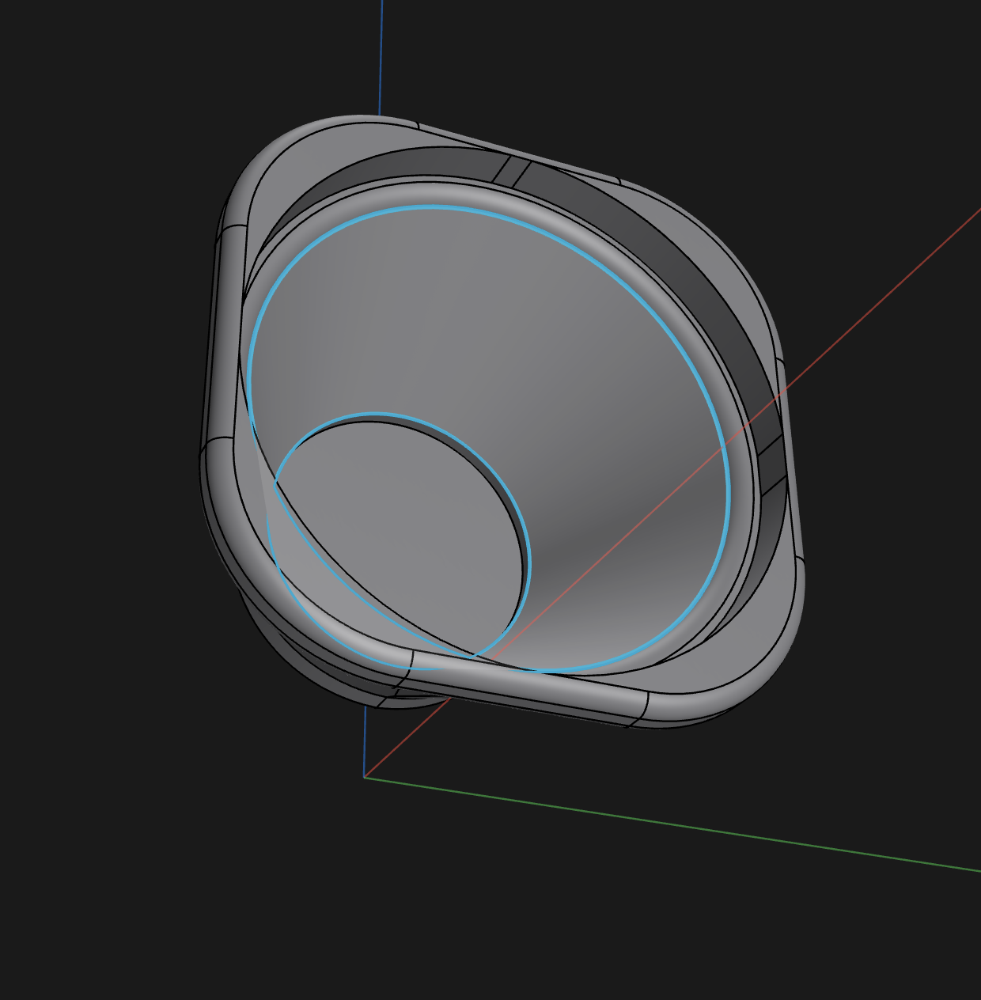
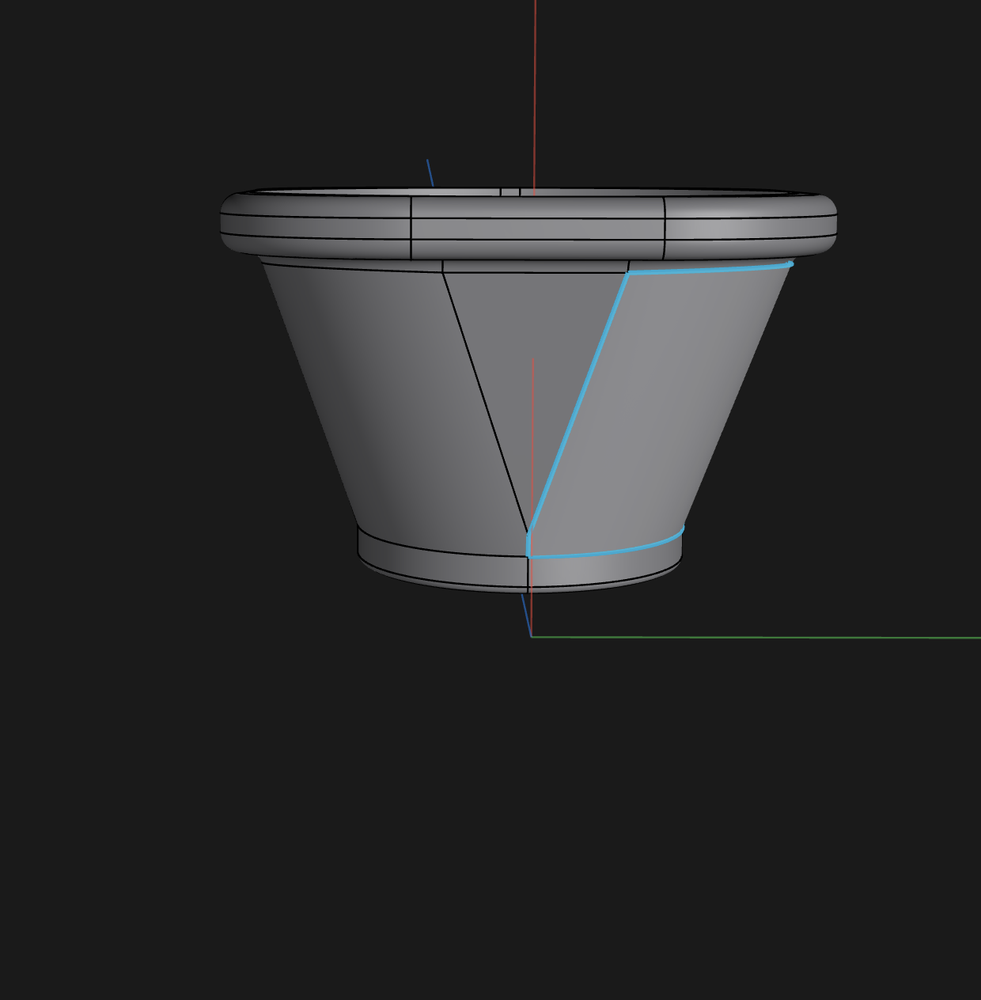
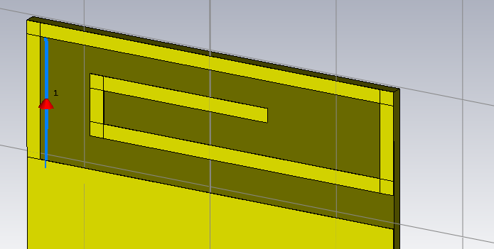
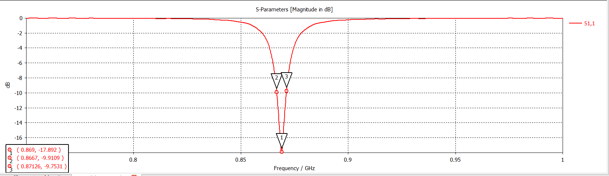
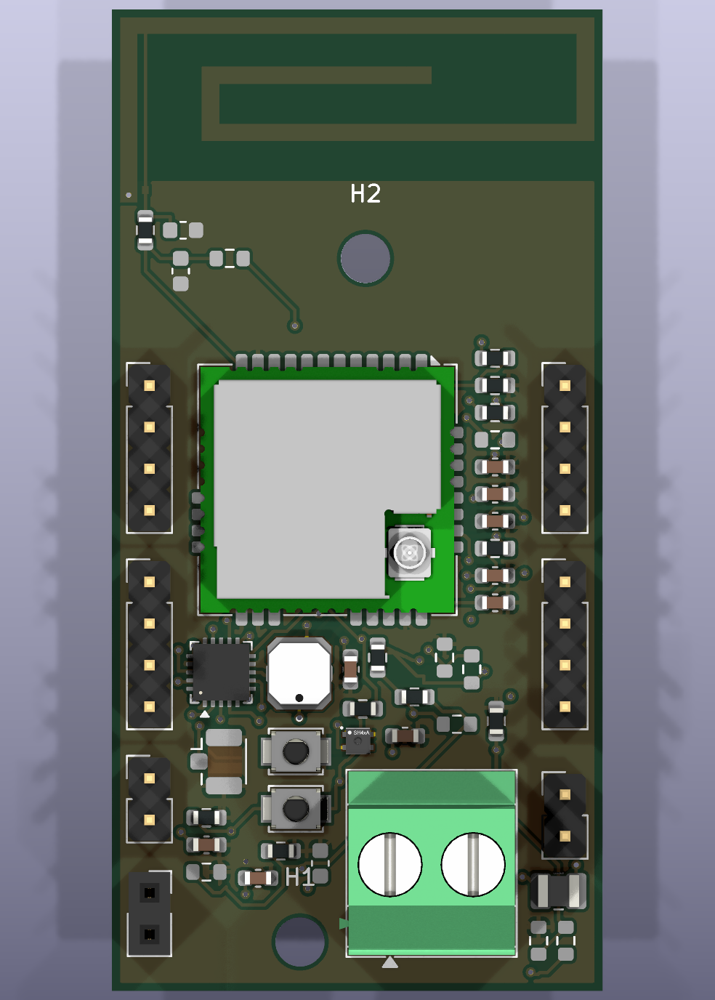
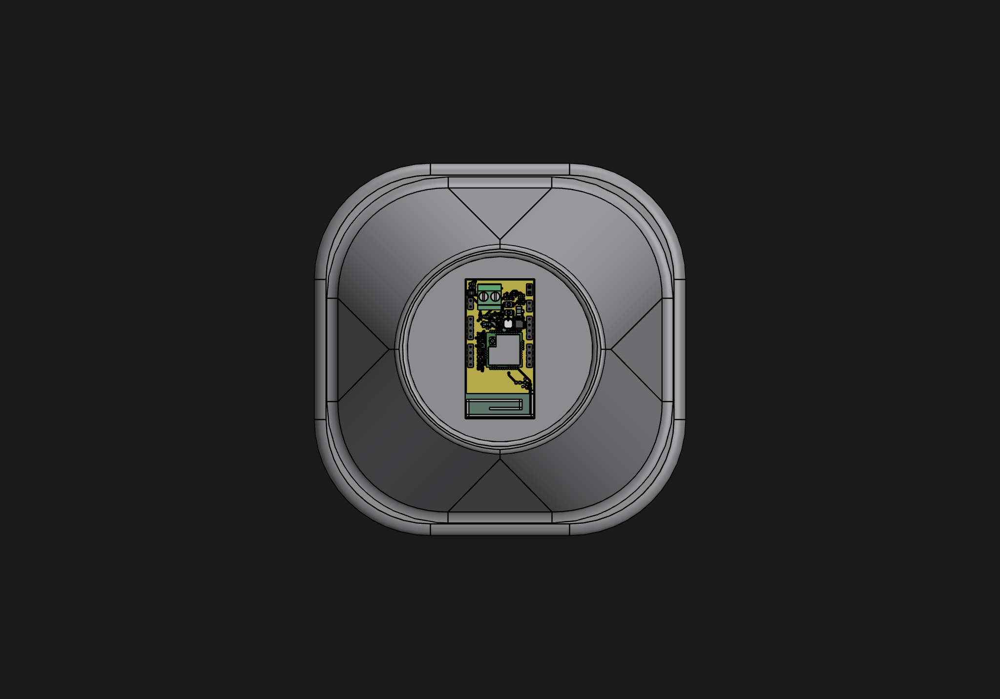
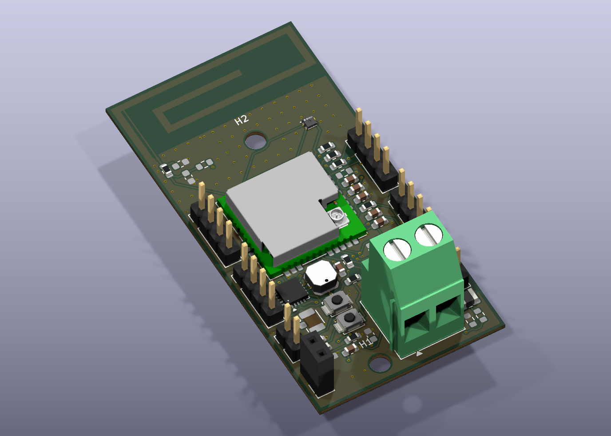

# Galerie SmartPot

**27 octobre 2026 — version actuelle : V4 routée, RF provisoire.** [Projet et contrôles](../pot_fleur_v4_nouvelle_antenne/README.md) : 0 violation DRC, 0 connexion manquante, 0 défaut de parité. Le S11 de la V4 avec son raccord physique n’a pas été calculé. Les essais CST X0 (−11,02 dB à 868 MHz) et X +0,40 mm (−3,75 dB à 868 MHz) concernent des modèles à port lumped distincts.

Les sections ci-dessous conservent l’historique des versions précédentes.

## Pot — vue intérieure

## Pot — vue latérale

## Antenne finale dans CST

## Simulation S11

## Champ lointain à 868 MHz

Les vues mécaniques et les simulations ont été fournies par Maxime. Voir [la fiche CST](../CST/README.md) pour l'interprétation des résultats et leurs limites.

## Antenne CST intégrée dans le PCB KiCad

Géométrie adaptée et raccord physique ajouté : [détails et resimulation](../pot_fleur/docs/INTEGRATION_ANTENNE_CST.md).

## PCB — rendu KiCad en perspective

## PCB — rendu KiCad de dessus

[Fichier STEP à importer dans le pot](../Mecanique/PCB/SmartPot_assemble.step). Le placement a été corrigé par Maxime dans Shapr3D ; voir la capture ci-dessous.

## Pot + PCB — assemblage corrigé dans Shapr3D

Capture native Shapr3D du 12 octobre 2026. Vue de dessous, composants vers l’extérieur. Cette capture atteste du placement visible ; les dégagements et les fixations ne sont pas validés par cette vue seule.

## Variante V2 — deux couches

[Routage F.Cu/B.Cu](../pot_fleur_v2_2couches/docs/Routage_V2.svg) · [Projet, contrôles et contraintes](../pot_fleur_v2_2couches/README.md)

## V3 provisoire — corrections du retour de Dorian

[Projet et hypothèses RF](../pot_fleur_v3_provisoire_4couches/README.md) · [Plan GND In2](../pot_fleur_v3_provisoire_4couches/docs/Plan_GND_In2.svg)
