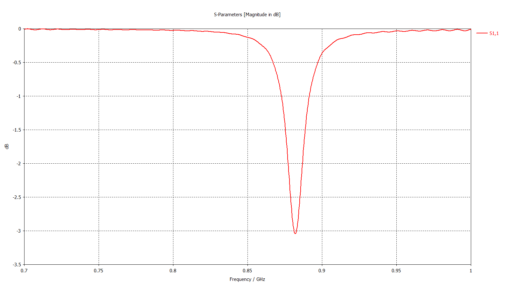
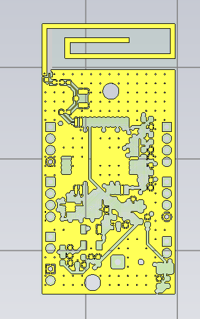
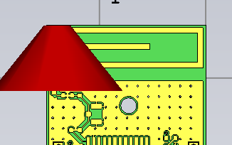

# Reconstruction CST 2019 et comparaison du port d'antenne

Travaux du 27 octobre 2026. Les projets initiaux sont conservés.

## Résultat du calcul

Le calcul du PCB complet avec le port replacé à l'antenne s'est terminé avec succès dans **CST Studio Suite 2019, Teaching License**. Le journal confirme que le critère d'énergie résiduelle de **−40 dB** est atteint. Ce critère temporel ne démontre pas la convergence spatiale du maillage.

| Grandeur | PCB complet, port à l'antenne |
|---|---:|
| Bande calculée | 700 à 1 000 MHz |
| Points exportés | 1 001 |
| Cellules | 46 410 |
| Pas temporels calculés | 77 688 |
| S11 à 868 MHz, interpolé entre les échantillons | −0,5574 dB |
| Minimum échantillonné | −3,0433 dB à 882,100 MHz |
| Points sous −10 dB dans la bande | Aucun |
| Durée totale du second essai | 5 min 58 s |

**Le résultat n'est pas quasi identique à la simulation d'antenne initiale.** La capture de référence affiche −17,892 dB à 869 MHz. La courbe numérique de cette référence n'est pas disponible : son S11 exact à 868 MHz et une comparaison point par point ne sont pas déduits de l'image.



## Pourquoi le fichier initial ne s'ouvrait pas

Le projet fourni avait été enregistré par CST Learning Edition 2026.4, avec ACIS 35. Le poste utilisé possède CST 2019, avec ACIS 28, et refusait son ouverture. Le modèle a été reconstruit dans CST 2019 depuis les 2 283 opérations de `../full_geometry_jobs.json`, sans changer simplement une étiquette de version.

- [Carte complète reconstruite, port à U1.12](SmartPot_V3_CARTE_COMPLETE_2019.cst) : 548 solides, configuration d'alimentation du modèle ODB++ initial.
- [Copie de comparaison, port à l'antenne et résultat calculé](SmartPot_V3_PORT_ANTENNE_2019.cst) : 549 solides, dont un petit raccord de masse ajouté pour le port.

Conserver le dossier compagnon `SmartPot_V3_PORT_ANTENNE_2019/` à côté du fichier du même nom. Il contient le modèle natif et la base des résultats 1D ; les gros caches de maillage et matrices ne sont pas livrés. L'export texte du S11 reste disponible indépendamment de CST.



## Port de comparaison

Le modèle ODB++ alimentait la carte depuis U1.12, au point (57,925 ; −71,965 ; 0,765) mm, vers la couche interne In1.Cu à Z = 0,638 mm. Ce point n'est pas celui de la simulation d'antenne initiale.

Le port de la référence est situé à gauche du radiateur. Ses points initiaux sont P1 = (−13 ; 28,55 ; 0,035) et P2 = (−13 ; 19 ; 0) mm, avec direction inversée. La transformation vers le repère du PCB complet est :

```text
X_nouveau = 65 + X_initial × 29 / 29,1
Y_nouveau = Y_initial − 80,05
Z_nouveau = Z_initial + 0,765
```

La copie de comparaison utilise un seul port S-Parameter de 50 ohms, direction inversée :

- P1 = (52,04467354 ; −51,49 ; 0,800) mm ;
- P2 = (52,04467354 ; −61,05 ; 0,765) mm ;
- longueur géométrique : 9,560064 mm.

P1 est décalé de **0,010 mm** vers l'intérieur du radiateur par rapport à la transposition exacte. Les volumes de découpe débordent également du cuivre en Z pour éviter une erreur ACIS d'arêtes confondues rencontrée lors du premier essai.

La piste d'alimentation physique ajoutée lors du transfert vers KiCad se trouvait sur le trajet de ce long port. Elle et sa borne sont retirées dans cette copie, et un petit raccord rejoint la masse au point P2. Le contrôle 2D depuis l'ODB++ confirme les contacts aux deux extrémités et l'absence de cuivre sur le trajet intérieur du port. Le port de référence ne reproduit donc pas l'alimentation physique complète de la carte fabriquée.

La branche de court-circuit de l'IFA reste conservée. Le PCB KiCad et les projets d'origine ne sont pas modifiés.



## Incidents et réglages du solveur

Le premier lancement a échoué pendant le calcul parallèle des matrices PBA : `B face could not be united` et incohérence de configuration d'arêtes TST. Aucun S11 de cet essai n'est utilisé.

Le second lancement emploie :

```vb
Mesh.SetParallelMesherMode "Hex", "none"
Mesh.SetMaxParallelMesherThreads "Hex", 1
Solver.MaximumNumberOfThreads 1
```

Le calcul est lancé depuis une macro de contrôle, hors de l'historique de construction. Les résultats du second essai sont normalisés et exportés en module de S11, en dB.

## Limites et suites

Le maillage reste grossier. CST signale **1 006 arêtes représentées en escalier et remplies de PEC**, **955 arêtes partiellement remplies de PEC**, ainsi qu'un avertissement SI. Une étude de convergence est nécessaire avant d'interpréter quantitativement ce résultat.

Le modèle conserve le PCB 30 × 60 mm, quatre couches, un FR4 provisoire à εr = 4,3 et tan δ = 0,02, les vias et les ponts conducteurs idéaux. La référence initiale utilise notamment un PCB 29,1 × 59,1 mm et un diélectrique εr = 4 sans pertes. Le port déplacé ne suffit pas à rendre ces modèles identiques.

Les corps des composants, leurs modèles électriques internes et parasites, le vernis, le pot et le boîtier ne sont pas représentés. La copie au port long est un modèle de comparaison, pas une validation RF du PCB assemblé.

Avant toute conclusion sur la carte réelle : raffiner le maillage autour du radiateur, du port et des couches de cuivre ; contrôler les avertissements ; étudier la convergence ; puis comparer des modèles ayant le même empilage et la même excitation, et vérifier l'alimentation physique.

## Données et preuves

- [Export numérique S11 en dB](resultats/S11_port_antenne_2019.txt).
- [Journal CST comprenant l'essai échoué puis l'essai réussi](resultats/journal_CST2019.log).
- [Diagnostic de l'échec parallèle](resultats/diagnostic_PBA_parallel.log).
- [Statistiques numériques extraites](resultats/bilan_S11.json).
- [Commandes de modification du port](port_antenne_reference2019.txt).

Les captures du dossier `captures/` sont des exports natifs de CST, non des images générées. Les vues de géométrie sont recadrées sans rééchantillonnage ; la vue du port montre sa sélection par la flèche rouge. La capture initiale de S11 reste accessible dans [la documentation d'antenne](../../../../CST/README.md).

## Relancer dans CST 2019

Ouvrir le modèle choisi et attendre la fin du chargement. Depuis le dossier de ces scripts :

```powershell
cscript //nologo simuler.vbs "C:\chemin\SmartPot_V3_PORT_ANTENNE_2019.cst"
```

Le script utilise la macro de contrôle `lancer_S11.mcr`, applique le réglage sans parallélisation qui a permis le calcul, puis enregistre le projet, un journal, l'export texte du S11 et une image BMP. Il ne remplace pas le diagnostic du journal CST ni une étude de convergence.
