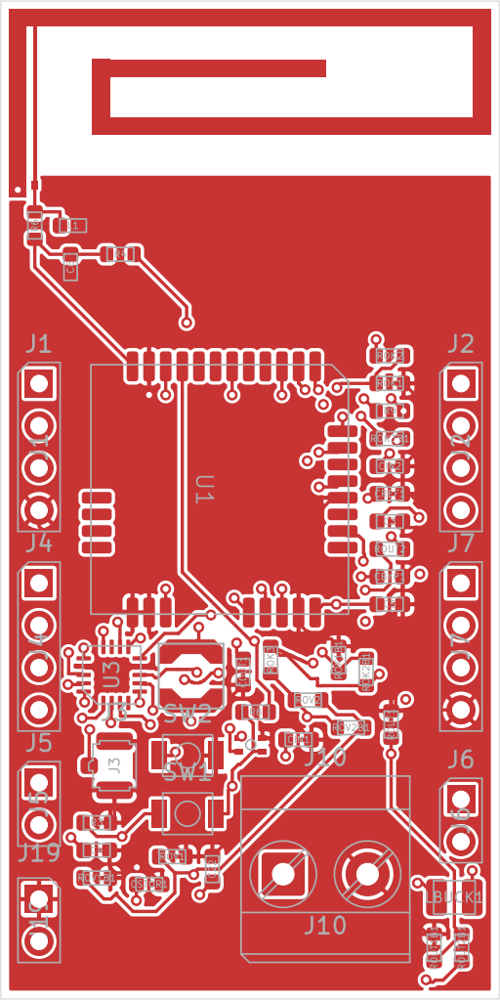

# Antenne CST intégrée dans KiCad — 12 octobre 2026

Source confirmée : [TP1_M2_Smart_2-3.cst](../../CST/TP1_M2_Smart_2-3.cst), conservé sans modification. La géométrie de ses six rectangles ANT1..ANT6 remplace le radiateur TI DN038 de A1, dans le schéma et sur le PCB.

## Contraintes et adaptation géométrique

Le choix confirmé par Maxime est de conserver le PCB **30 × 60 mm** et de réajuster légèrement l'antenne avant resimulation. Le cuivre respecte la marge de 0,5 mm aux bords : sa largeur passe de 29,1 à 29,0 mm, avec le facteur X=29/29,1 (réduction d'environ 0,344 %). Le haut du radiateur est à Y_PCB=50,5 mm et sa base à Y_PCB=60,5 mm. La hauteur de 10 mm du dessin CST est conservée.

La transformation du repère source CST vers le repère KiCad est :

- X_KiCad = 65 + X_CST × (29/29,1) ;
- Y_KiCad = 80,05 − Y_CST.

Les primitives et l'origine du raccord sont conservées dans [CST_IFA_KICAD_GEOMETRIE.json](CST_IFA_KICAD_GEOMETRIE.json). L'empreinte est [SmartPot_RF:CST_IFA_868MHz_SmartPot](../footprints/SmartPot_RF.pretty/CST_IFA_868MHz_SmartPot.kicad_mod). Les anciens fichiers TI restent disponibles pour l'historique, mais ne sont plus utilisés par A1.

## Alimentation et masse de l'IFA

La branche de court-circuit de cette antenne F inversé doit être reliée à GND. Le raccord intentionnel entre la broche RF 1 et la broche de masse 2 est déclaré par un **net tie** dans l'empreinte. Ce raccord est limité à l'antenne ; il ne supprime pas les contrôles de courts-circuits des autres pistes.

Le port discret CST reliait P1=(-13 ; 28,55 ; 0,035) à P2=(-13 ; 19 ; 0). Une source lumped de cette longueur ne constitue pas une piste de PCB. Une alimentation physique de largeur provisoire **0,20 mm** a été ajoutée depuis le point RF du radiateur jusqu'à une borne près de la masse, à X=52,044674 mm, Y=61,05 mm. Cette piste n'est pas présente dans le modèle CST d'origine : sa présence et son couplage avec la branche de court-circuit doivent être simulés.

L'antenne est en cuivre F.Cu uniquement. Une exclusion de pistes, vias et remplissages couvre la zone rayonnante sur les quatre couches ; les pads de cuivre du radiateur et de son raccord sont admis. Les plans de masse démarrent à Y=60,5 mm. Ils ne constituent pas encore une reproduction électromagnétique exacte de la masse du modèle CST à une face.

## Réseau d'adaptation — 0603 conservé

| Référence actuelle | Montage initial | Fonction |
|---|---|---|
| R6 | 0 Ω, 0603 | Série RF ; remplace C7=1 pF de l'ancienne adaptation TI |
| C6 | DNP, 0603 | Shunt optionnel côté radio |
| L1 | DNP, 0603 | Shunt optionnel côté antenne ; ancienne valeur TI=12 nH non imposée |
| R4 / J3 | DNP | Branche de test U.FL conservée |

Cette configuration permet un départ sans imposer le réseau 1 pF / 12 nH de l'ancienne antenne. R6 et les shunts restent à caractériser pour le modèle physique ; 0 Ω n'est pas une validation d'adaptation à 50 Ω. Les boîtiers RF restent en 0603, conformément à la contrainte du projet. C22 reste non monté. Le PCB contient toujours 48 empreintes, dont 12 non montées dans cette version.

## Vérification

- [DRC et parité schéma/PCB](DRC_antenne_CST.txt) : **0 violation, 0 connexion manquante, 0 problème de parité**.
- [ERC](ERC_antenne_CST.txt) : **0 erreur, 6 avertissements préexistants**.
- [Aperçu cuivre dessus](APERCU_antenne_CST.pdf).
- Les règles d'isolation et de largeur du projet ont été conservées ; les réglages ERC d'origine ont été préservés.

Sauvegarde complète avant remplacement : `sauvegardes/avant_antenne_CST_20261012/` (locale, exclue du dépôt).

## Resimulation nécessaire

Les captures S11/farfield fournies restent les résultats du **modèle CST original**, pas ceux de cette carte adaptée. La réduction de largeur, l'alimentation physique, le PCB 30 × 60 mm, les plans internes, les composants RF 0603, le masque de soudure et le pot peuvent déplacer la résonance. La largeur de ligne n'est pas certifiée 50 Ω tant que l'empilage du fabricant n'est pas connu.

Les [exports pour CST](../../CST/integration_kicad/README.md) permettent de repartir du cuivre KiCad réellement intégré. Le fichier CST d'origine n'a pas été modifié ni resimulé ici. La revue du placement et des boucles du BQ25570 reste nécessaire avant fabrication, indépendamment de l'import d'antenne.
