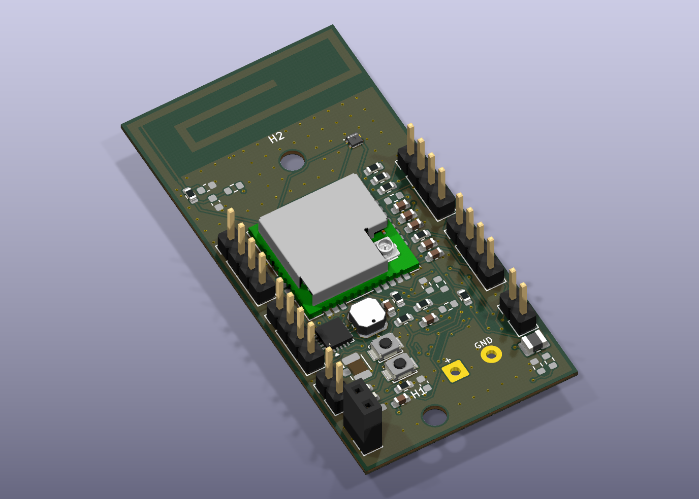

# SmartPot V2 — PCB à deux couches

Version alternative créée le **14 octobre 2026**. Ouvrir [pot_fleur.kicad_pro](pot_fleur.kicad_pro) dans KiCad. La version quatre couches reste dans `../pot_fleur/`.

Le PCB conserve **30 × 60 × 0,8 mm**, les 50 empreintes du projet, les connecteurs latéraux, les deux trous non métallisés Ø 3 mm et l’antenne issue de CST. Le cuivre et les pistes utilisent exclusivement **F.Cu et B.Cu**. Le capteur SHT40 U4 est placé à (73,5 ; 66,5) mm pour dégager le routage. J10 est adapté pour des fils soudés directement. Les positions des autres empreintes sont conservées, avec seulement les arrondis numériques d’export. Le réseau RF reste en 0603 ; les composants DNP conservent leur statut, notamment C22.

[Voir le routage des deux couches](docs/Routage_V2.svg) · [STEP assemblé pour la mécanique](3D/SmartPot_V2_assemble.step)

## Contrôles enregistrés

| Contrôle | Résultat |
|---|---|
| Connexions manquantes | **0** |
| Parité schéma/PCB | **0 problème** |
| DRC | **0 violation** |
| ERC | **0 erreur, 6 avertissements** |
| Couches de cuivre | **2**, F.Cu / B.Cu |

J10 conserve ses deux pastilles traversantes Ø 2,6 mm, trous métallisés Ø 1,3 mm et entraxe 5,08 mm, aux positions existantes. Le bornier est remplacé par une empreinte locale de soudure directe, sans boîtier ni modèle 3D. La pastille 1 est l’entrée positive et la pastille 2 est GND. Le marquage +/GND est ajouté. Le schéma conserve le repère P-MFC de cette entrée ; aucun changement électrique n’est apporté. Le conflit de zone d’occupation H1/J10 disparaît avec l’emprise réelle des pastilles. Aucun contrôle n’a été masqué. Prévoir le passage et la tenue mécanique des fils hors de la tête de vis. Voir les rapports [DRC texte](docs/DRC_V2.txt), [DRC JSON](docs/DRC_V2.json) et [ERC](docs/ERC_V2.txt).

## Paramètres à transmettre au fabricant

- Pistes : minimum **0,15 mm** ; isolation nominale entre réseaux **0,20 mm** selon les règles du projet et les règles locales des empreintes.
- Vias traversants : **Ø 0,50 / perçage 0,30 mm** (210) et **Ø 0,40 / perçage 0,20 mm** (32). Aucun via aveugle ou microvia n’est utilisé.
- Certains vias compacts se trouvent dans des pastilles CMS, notamment pour reprendre des masses. Faire confirmer le traitement de ces vias par le fabricant : un trou ouvert peut absorber la soudure lors du montage. Le DRC ne vérifie pas ce procédé.
- Masses sur les deux faces, reliées par vias. Les pastilles CMS de masse et la masse de J10 sont reliées directement aux zones ; leur soudure peut demander davantage de chaleur.
- La zone d’exclusion de l’antenne s’applique aux deux faces.

## Validation restante

Cette V2 est un routage complet à deux couches, **pas une autorisation de fabrication**. La suppression des plans internes change le retour des courants et la structure RF. La piste d’alimentation RF de 0,20 mm n’est pas certifiée à 50 Ω sur ce PCB à deux couches de 0,8 mm. Resimuler l’antenne et son raccord dans CST avec le substrat du fabricant et l’environnement du pot ; les captures CST antérieures ne valident pas cette V2. Revoir également les boucles et découplages du BQ25570 et vérifier le passage des fils autour de H1 avant fabrication.

Les bibliothèques et modèles locaux sont inclus et utilisent `${KIPRJMOD}`. Le STEP exclut le bornier J10 et les composants DNP et contient le cuivre extérieur ; il représente la V2 et ne remplace pas le placement corrigé du pot dans Shapr3D.

## Masques et fichiers de fabrication

[Masque de vernis dessus](docs/Masque_V2_dessus.svg) · [Masque de vernis dessous](docs/Masque_V2_dessous.svg) · [Gerbers, perçages et archive](fabrication/README.md)

Les masques F.Mask/B.Mask représentent les **ouvertures du vernis**, et non les pistes de cuivre. Les Gerbers incluent également F.Paste/B.Paste pour un éventuel pochoir de pâte à braser. Ces exports sont issus de cette V2 ; les validations RF et du procédé de vias dans les pastilles restent nécessaires avant commande.
