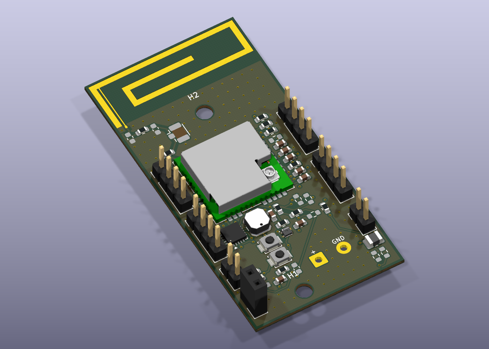

# SmartPot V3 provisoire — retour de Dorian Diana

**25 octobre 2026 — copie de travail quatre couches, non validée pour fabrication.**

Ouvrir [pot_fleur.kicad_pro](pot_fleur.kicad_pro) dans KiCad. Les versions `../pot_fleur/` et `../pot_fleur_v2_2couches/` sont conservées ; cette V3 est la version préparée pour examiner les corrections du retour du 22 octobre.

[Routage](docs/Routage_V3.svg) · [Plan de masse interne In2](docs/Plan_GND_In2.svg) · [Ouvertures du vernis dessus](docs/Masque_V3_dessus.svg) · [STEP](3D/SmartPot_V3_provisoire.step)

## Routage redressé — 26 octobre 2026

Les portions restantes en petits zigzags ont été reprises avec une préférence pour les sections horizontales, verticales et les coudes à 45°. **27 trajets principaux** ont été redessinés : 267 segments remplacés par 103 ; **63 fragments entièrement contenus dans des pastilles** ont été supprimés. Le PCB passe de 674 à **447 segments**, sans déplacement des composants ni modification des largeurs de pistes ou des vias. Les petits raccords imposés par les sorties de pastilles et les passages serrés sont conservés lorsqu’ils sont nécessaires.

Les trois réseaux RF calculés ne sont pas modifiés. Le schéma, les 204 vias, les plans de masse et la zone d’antenne sont conservés. Contrôle du 26 octobre : **0 violation DRC, 0 connexion manquante, 0 problème de parité** ; aucune exclusion ajoutée. Vue 3D, routage et STEP actualisés.

La comparaison est une vue géométrique des pistes et des pastilles extraite du PCB ; les plans de cuivre sont masqués dans cette illustration pour lire les trajets.

## Modifications appliquées

| Demande | Réalisation dans cette copie |
|---|---|
| Plan de masse interne 2 manquant | Zone GND sur In2.Cu ajoutée et remplie ; les exclusions de l’antenne sont conservées |
| Relier les plans de masse | 130 vias GND supplémentaires répartis sur la carte, sans cuivre ajouté dans la zone rayonnante |
| Vias de 0,3 mm minimum | Les 204 vias sont traversants, cuivre Ø 0,60 mm / perçage Ø 0,30 mm ; le minimum de perçage est inscrit dans les règles |
| Détours et zigzags | 18 trajets simplifiés, environ 2,93 mm de détour supprimé ; une ancienne branche d’alimentation a ensuite été reprise pour dégager la référence RF |
| RF courte, ordre des composants | U1.12 → R4 (0 Ω) → nœud U.FL J3 → shunt C6 → R6 (0 Ω) → shunt L1 → antenne A1 |
| Dimension de la ligne RF | Largeur 0,229278 mm calculée dans le calculateur KiCad avec l’empilage **provisoire** ci-dessous |
| Antenne sans vernis | Ouvertures F.Mask ajoutées aux huit pastilles du radiateur et de son alimentation ; bibliothèque locale synchronisée |

La longue dérivation vers J3 est supprimée. J3 est déplacé au-dessus du module radio, sur le trajet du réseau d’adaptation. R4 doit désormais être monté pour assurer la continuité vers l’antenne et est donc déclaré monté ; R6 reste monté. J3 conserve son statut optionnel DNP : ses pastilles sont sur le trajet RF et on peut monter la prise pour les mesures. C6 et L1 restent DNP. **C6 conserve provisoirement son symbole de condensateur**, conformément au repère visible sur la capture : la demande de deux inductances de shunt fait l’objet d’une question envoyée à Dorian. Aucune valeur de shunt n’est supposée validée. Tous les emplacements d’adaptation restent en 0603 ; C22 reste non monté.

J10 reprend les deux pastilles pour fils soudés directement de la V2, aux mêmes coordonnées et sans boîtier de bornier. Les trous de fixation et les connecteurs latéraux sont conservés. Le schéma et le PCB sont synchronisés avec ces modifications.

## Calcul RF provisoire — à faire confirmer

| Paramètre du calculateur KiCad | Valeur |
|---|---|
| Modèle | Microstrip, plan de référence In1.Cu |
| Fréquence | 0,868 GHz |
| Impédance visée | 50 Ω |
| Permittivité relative supposée | 4,3 |
| Distance diélectrique F.Cu / In1.Cu | 0,127 mm |
| Épaisseur de cuivre supposée | 0,035 mm |
| Largeur synthétisée | **0,229278 mm** |

[Capture du calcul réalisé dans KiCad](docs/Calcul_RF_KiCad_provisoire.png).

L’empilage provisoire de 0,8 mm est enregistré dans le PCB : cuivre 0,035 / diélectrique 0,127 / cuivre 0,035 / cœur 0,406 / cuivre 0,035 / diélectrique 0,127 / cuivre 0,035 mm. Les diélectriques portent explicitement la mention « FR4 PROVISOIRE » ; ce n’est pas un empilage fourni ou approuvé par un fabricant. Le cuivre de masse supérieur est écarté autour des pistes RF pour correspondre au modèle microstrip retenu. Une piste PWR proche du raccord radio est passée sur In2.Cu afin de dégager le plan In1.Cu sous la ligne RF.

**Le calcul de largeur ne certifie pas l’impédance de la carte réelle.** Les discontinuités des 0603/U.FL, le raccord physique dans la zone d’antenne et la géométrie CST doivent être resimulés avec l’empilage réel. Le radiateur et sa fine alimentation à l’intérieur de la zone sans plan ne sont pas des lignes microstrip à 50 Ω ; leur géométrie issue de CST est conservée. Les résultats S11/farfield du CST d’origine ne valident pas cette V3.

## Contrôles enregistrés

- [DRC texte](docs/DRC_V3.txt) / [JSON](docs/DRC_V3.json) : **0 violation, 0 connexion manquante, 0 problème de parité**. Aucune exclusion DRC ajoutée.
- [ERC](docs/ERC_V3.txt) : **0 erreur, 6 avertissements**.
- PCB 30 × 60 × 0,8 mm, quatre couches ; bibliothèques et modèles locaux inclus.

Ces résultats vérifient les règles configurées et la cohérence schéma/PCB ; ils ne constituent pas une validation électrique, RF ou de fabrication. La revue des boucles du BQ25570 reste nécessaire.

## Précisions demandées

Un mail de réponse à Dorian a été envoyé le 25 octobre pour préciser : l’empilage et le fabricant à utiliser ; le sens du minimum de 0,3 mm des vias ; le type des deux shunts et leur maintien non monté avant accord. La V3 reste provisoire en attendant ces précisions et une revue finale. Aucun fichier de commande de fabrication n’est proposé pour cette V3.
