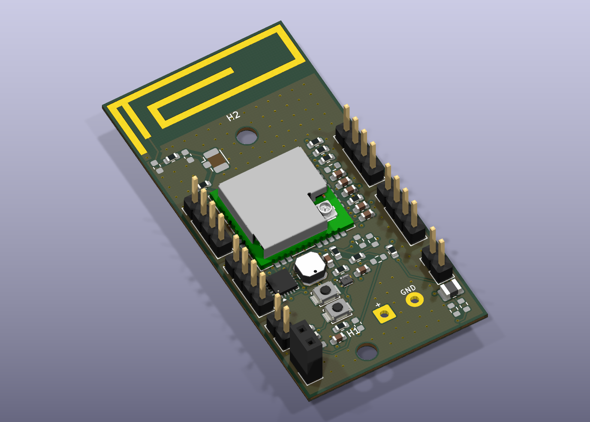
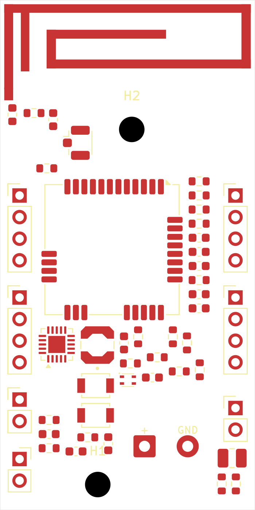

# SmartPot V4 — routage quatre couches, RF provisoire

**Référence retenue par Maxime : X0, S11 source −11,020993 dB à 868 MHz. Le décalage X +0,40 mm n’est pas appliqué.**

## État actuel : carte routée, 27 octobre 2026

Le PCB courant est routé sur quatre couches : **415 segments, 204 vias, 0 connexion manquante, 0 violation DRC, 0 défaut de parité**. Rapport : [DRC V4 routée](docs/DRC_V4_routee.json). Le contrôle géométrique des extrémités des 415 segments ne trouve aucun bout libre hors pastille/via/piste du même net. Relevé : [audit](docs/Audit_pistes_V4.csv).

Les liaisons électroniques dont le placement et les réseaux n'ont pas changé reprennent les tracés redressés et contrôlés de la V3. Les quatre plans GND et les vias de couture sont rétablis. Les deux segments approchant l'ancienne alimentation d'A1 sont remplacés. Un via GND est déplacé de (53,2 ; 61,5) à (54,2 ; 61,5) mm pour dégager le nouvel accès RF. Aucun nouveau composant ajouté.

Nouveau raccord, F.Cu, largeur **0,229278 mm provisoire** : L1.2 (51,45 ; 62,7) → (52,95 ; 61,2) → extrémité de la branche (52,95 ; 58,4). Le chemin radio → R4 → nœud J3 → C6 → R6 → L1 → A1 conserve les réseaux du schéma. Les 0 ohm R4/R6 sont montées ; C6/L1/J3 restent DNP. Empreintes RF 0603 conservées.

**Ce raccord remplit physiquement une partie de l'espace où le modèle CST utilisait un port lumped. Ce n'est pas le même modèle RF.** Il faut importer cette V4 et l'exciter côté U1.12, vérifier la continuité des 0 ohm et la convergence du calcul. Le résultat source -11,02 dB ne s'applique pas à cette carte. Le radiateur n'a pas été optimisé et aucun S11 de la V4 n'est annoncé. L'impédance de la portion sans plan sous l'antenne n'est pas garantie par le calcul microstrip.

L'exclusion de cuivre et de vias dans la zone antenne reste conservée. Une entrée étroite autorise uniquement le passage géométrique de la piste d'alimentation ; une seconde exclusion y interdit toujours les plans et les vias. Les dégagements de cuivre F.Cu autour du trajet RF sont reconstruits depuis les pistes réelles. L'empilage reste provisoire.

[Routage](docs/V4_routee.svg) · [Export ODB++ pour resimulation](CST_import/SmartPot_V4_RF_PROVISOIRE_ODB.zip)

## Historique de la base non routée

27 octobre 2026. Copie indépendante de la V3 ; les versions antérieures ne sont pas modifiées.

Ouvrir `pot_fleur.kicad_pro` puis le PCB. Les 50 empreintes, les trous, le contour 30 x 60 mm, le schéma hiérarchique, les bibliothèques et les modèles 3D locaux sont conservés. Quatre couches sont configurées ; l'empilage est toujours provisoire.

## Ce qui a été retiré

415 segments de piste, 204 vias et les quatre anciens plans de cuivre. Les exclusions de l'antenne restent présentes. Le radiateur est remplacé par une nouvelle empreinte dédiée ; les deux anciennes pastilles de la fine alimentation centrale (piste 0,2 mm et borne inférieure) sont supprimées.

## Nouvelle antenne candidate

Source consultée sur GitHub : `CST/ANTENNE_868_3QUARTS/README.md`, blob ac7ca6c2ba9f60c7c3fc452646da3ff86fcac230, et `PISTE_HAUT_3QUARTS_LUMP.md`, blob 9ae66d27489ae57d0cf047928ce0c38ac19476b8. Copies documentaires dans docs/SOURCE_CST_*.md.

Le radiateur et sa branche de court-circuit restent aux coordonnées de la V3. La nouvelle alimentation est un rectangle de cuivre 1 x 7 mm : X=52,45..53,45 ; Y KiCad=51,4..58,4 mm. Il correspond à Y CST=-58,4..-51,4 mm. Ouverture de vernis conservée sur le cuivre de l'antenne. L'empreinte porte le nom `SmartPot_RF:CST_IFA_868MHz_3QUARTS_V4`. Le schéma référence cette nouvelle empreinte.

Le port lumped CST entre l'extrémité basse et GND n'est PAS du cuivre. Il n'a pas été ajouté sous forme de court-circuit. Le raccord d'alimentation physique vers la radio, son adaptation et le retour de masse restent à concevoir. La nouvelle branche n'est pas reliée à l'ancien chemin RF puisque le routage est retiré.

## Contrôle de cette base

DRC : 0 violation géométrique, 111 connexions manquantes, 0 défaut de parité schéma/PCB. Les connexions manquantes sont attendues pour une carte non routée. Aucun masque d'erreur ajouté. Voir docs/DRC_V4_base_non_routee.json.

## Statut RF et suite

Le résultat source documenté est -11,020993 dB à 868 MHz, point fréquentiel unique, et non l'objectif -14 dB. Il ne valide pas cette carte non routée : les masses et vias ont volontairement été retirés pour reprise. Aucun résultat CST de cette V4 n'est annoncé.

Avant routage final : définir l'alimentation physique, confirmer l'empilage et les masses, puis simuler avec ce raccord réel et vérifier la convergence. Reprendre ensuite les plans, le routage des signaux/alimentations et les vias. Les résistances d'adaptation restent en 0603 et C22 reste DNP.

La base KiCad provient du commit 16d3d1a. Le dépôt a ensuite été synchronisé jusqu’au commit 380e4b9, qui contient également l’essai temporel X +0,40 mm. La V4 actuelle conserve explicitement la géométrie X0 et son raccord physique provisoire ; elle ne reprend pas ce décalage. Les modèles CST récents sont disponibles dans le dossier CST du dépôt.

## Modèles 3D

[Carte assemblée STEP](3D/SmartPot_V4_RF_provisoire.step) · [Modèle coloré GLB](3D/SmartPot_V4_RF_provisoire.glb). Exports natifs KiCad, composants DNP exclus ; conserver les fichiers KiCad comme source éditable. Ces exports mécaniques ne constituent pas un modèle électromagnétique avec ports/matériaux validés.
